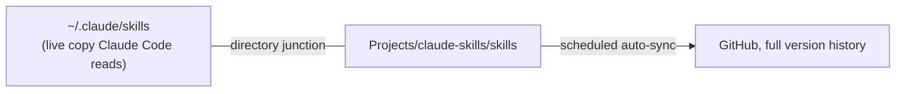

# Claude Skills Library

> My version-controlled library of custom Claude skills: reusable playbooks that teach Claude a specific job, like troubleshooting a Windows install.

**When:** June 2026 – present
**Stack:** Claude Code skills (`SKILL.md`) · Windows directory junction · Git / GitHub auto-sync
**My role:** Wrote and maintain the skills and the sync setup.

> The skills reference internal systems at my workplace, so the full library stays private. This page describes what's in it and how it's set up.

---

## What a skill is

A skill is a small folder with a `SKILL.md` file that gives Claude a repeatable procedure it can load when the task calls for it. I write them for jobs I do over and over, so the steps are the same every time.

## Skills in the library

| Skill | What it does |
|---|---|
| Windows install troubleshooting | A symptom-to-fix playbook for reimaging laptops: 3F0 boot errors, Secure Boot, Intel VMD hiding the SSD, a USB that won't boot, and the Windows 11 OOBE local-account bypass |
| CRM export handling | How to read and work with CRM data exports consistently |

## How the backup works

- The live skills stay where Claude Code reads them, so edits take effect right away.
- A Windows **directory junction** puts that folder inside a Git repository without moving it. Git follows the junction and commits the real files.
- The repository rides on the same scheduled auto-sync as my other project repos, so every edit is backed up with history and no manual Git steps.

---

*See my [profile](https://github.com/Matteoinfl) for my other projects.*
